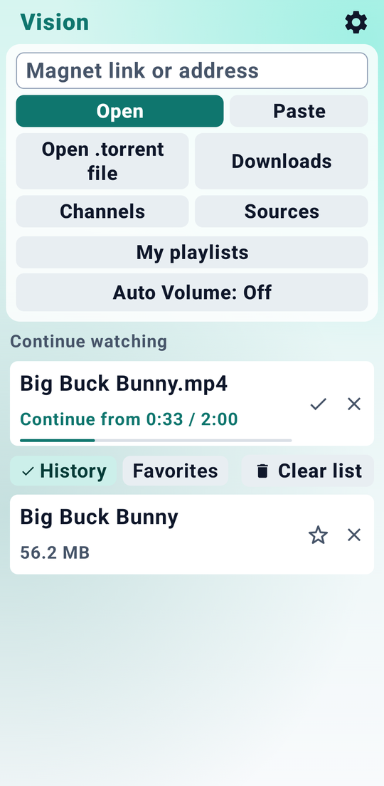
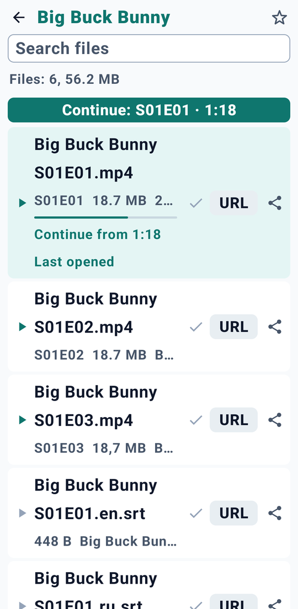
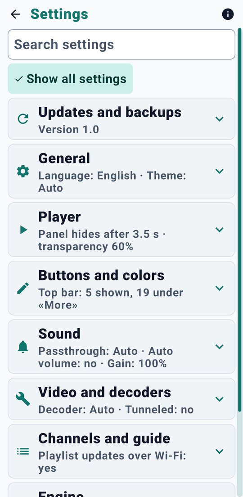
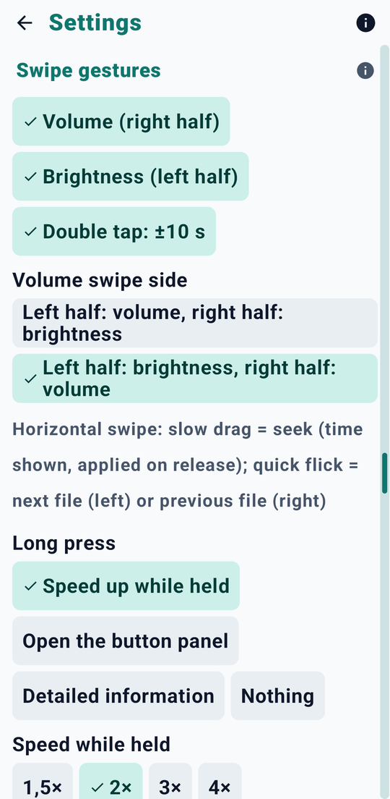
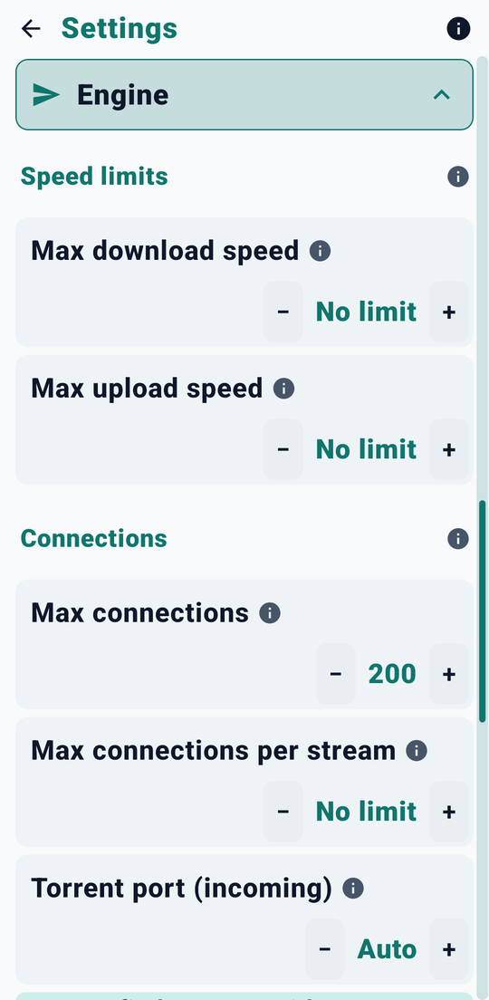
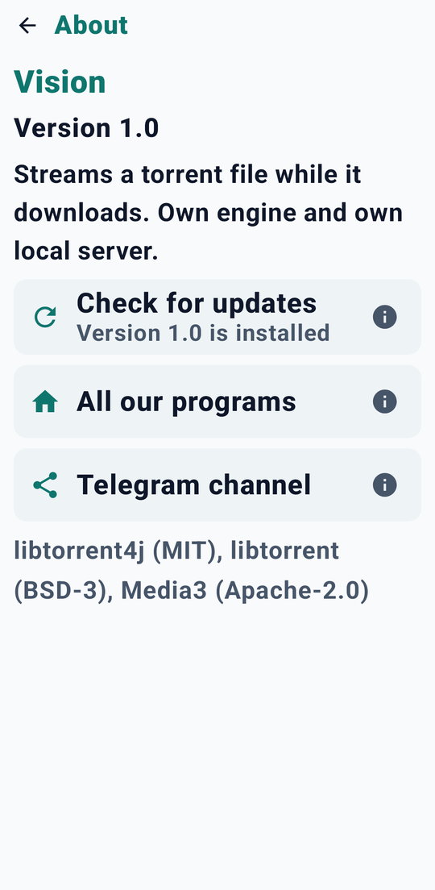
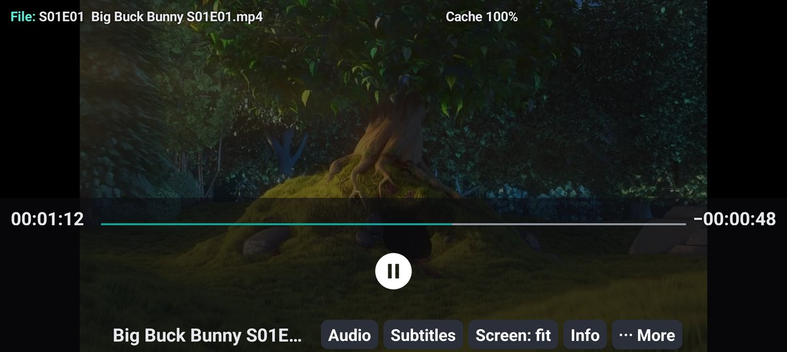
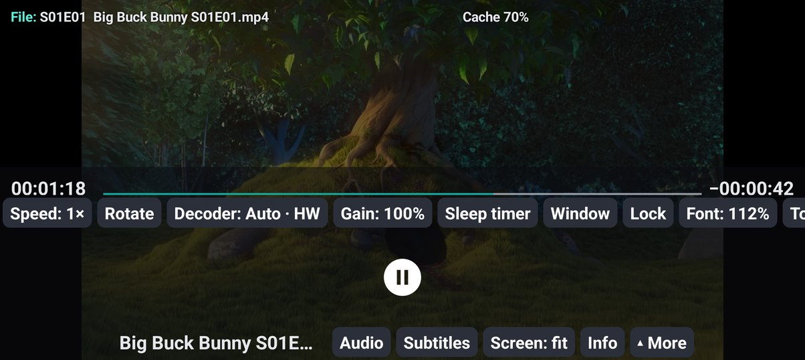

[English](README.md) · [Русский](README.ru.md) · [Українська](README.uk.md)

🌐 All our programs: https://drugoj00.github.io/ · Telegram channel: https://t.me/PhoneInWindowSound

# Vision

Media player for Android phones and TV boxes: torrents, IPTV, network folders, auto volume. Own engine, no ads.

Vision plays video, audio and TV channels from files, links, playlists, network folders (SMB, WebDAV, DLNA, FTP, SFTP) and torrents, with playback while downloading. Auto Volume keeps the sound even and tames loud commercials. Paste a link, open a file or a playlist, press play.

**Vision provides no content. The user is responsible for complying with the copyright laws of their country.**

⭐ If the app is useful, please star this repository: it costs nothing and helps other people find it.

## Download

**Version 1.0.** [Vision-1.0.apk](https://github.com/drugoj00/torrent-player/releases/download/v1.0/Vision-1.0.apk) · [Releases](https://github.com/drugoj00/torrent-player/releases)

SHA-256: `01dbef93104bc3ce3d5b0be5c436bee750c90cbd5bdf7d8842cefc61c0db4ec0`

Not on Google Play: download the APK here. Android may warn about installing from an unknown source.

## What's new in 1.0

- Torrents by magnet or .torrent, playback while downloading
- Episodes with watch progress, "Continue" and auto-play of the next one
- Auto Volume: TV mode cuts loud commercials
- IPTV playlists, channel panel over the video, TV guide
- Swipe gestures, A-B repeat, bookmarks, speed 0.25-4x, picture-in-picture
- Network folders: SMB, WebDAV, DLNA, FTP, SFTP
- Built-in software decoders for video, audio and AV1
- Settings in groups with search, backup and restore
- Russian, Ukrainian and English, light, dark and black themes

## Features

- **Torrents.** A magnet link, a .torrent file or link, or "Share" from another app. The file list comes first, then only the chosen file is downloaded, in a window around the playback position. Seek anywhere.
- **Player.** Media3 with external subtitles (.srt, .ass, .vtt), audio and subtitle tracks, screen size modes, speed, A-B repeat, bookmarks, picture rotation and mirror, volume gain up to 200%, swipe gestures, sleep timer, picture-in-picture and an own floating window. Remote, touch and mouse.
- **Auto Volume.** A TV mode that tames loud commercials; a switch in settings and in the Audio panel.
- **IPTV.** M3U, M3U8, XSPF and PLS playlists, a transparent channel panel with groups, favorites and search, an XMLTV guide.
- **Sources.** SMB, WebDAV, DLNA, FTP, SFTP and device folders; "Video" and "Audio" collections with a "where I stopped" bar.
- **Local server.** Serves the file over HTTP with Range support; "Network access" opens it to the local network (VLC, a TV, a browser). A page in the browser adds a torrent from a phone or a computer.
- **Engine.** Speed limits, connections, port, DHT and LSD, mobile network, buffer ahead, cache on device memory or an external drive.
- **Settings.** Nine groups with search, full backup and restore.
- **Updates.** Update check on GitHub with a file check and a "What's new" window.

## Requirements and limits

- Android 6.0 or newer (ARMv7, ARM64, x86_64).
- Internet is needed for torrents and IPTV. In countries that prohibit torrents they are blocked until confirmation; the country is detected offline. NFS and the Ace Stream engine are not supported.
- Software AV1 on weak boxes: 720p plays smoothly, 1080p drops frames, 4K is too heavy.
- The floating window needs "Display over other apps"; picture-in-picture works where the system supports it.
- Tested on an Android 15 phone and a TV box. Not verified: the torrent engine and part of the Engine settings on a TV box, the TV layout of the new player controls, car head units, Stalker portals, TV guide archives (zip, JTV), reminders, external-drive cache, Dolby/DTS passthrough on real HDMI equipment.

## Screenshots

   

 

 

## License

GPL-3.0. Libraries: libtorrent4j (MIT), libtorrent (BSD-3), Media3 (Apache-2.0), FFmpeg (LGPL-2.1+). The demo video in the screenshots is "Big Buck Bunny" by Blender Foundation (CC BY 3.0).
