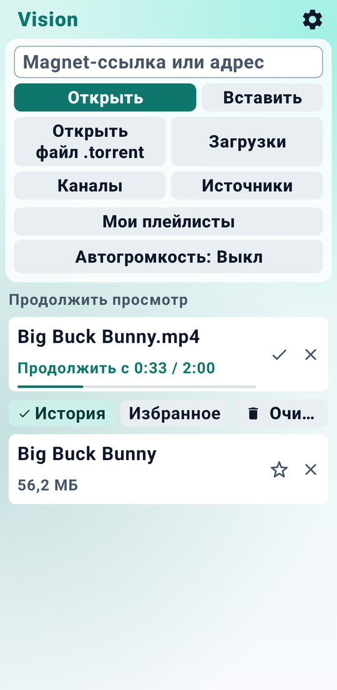
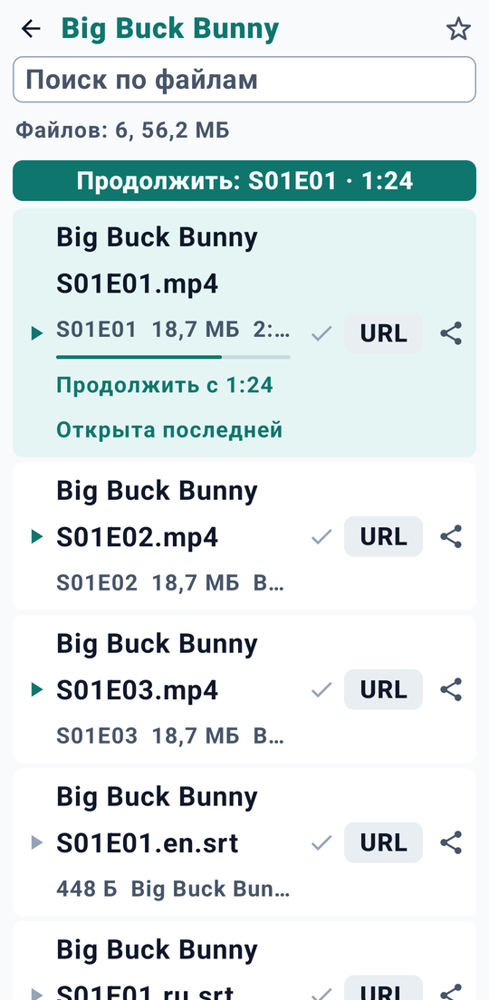
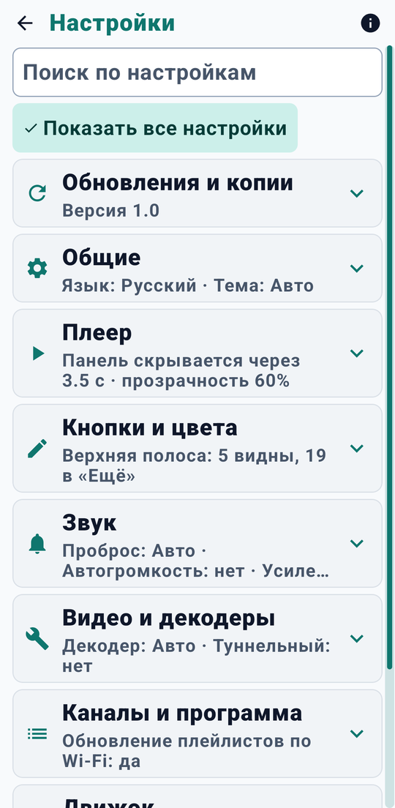
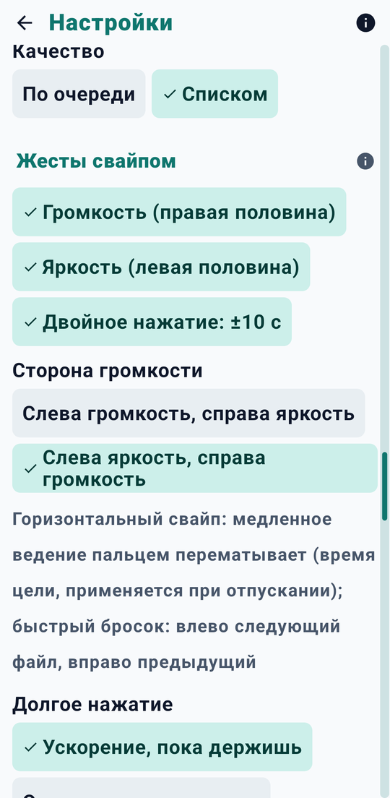
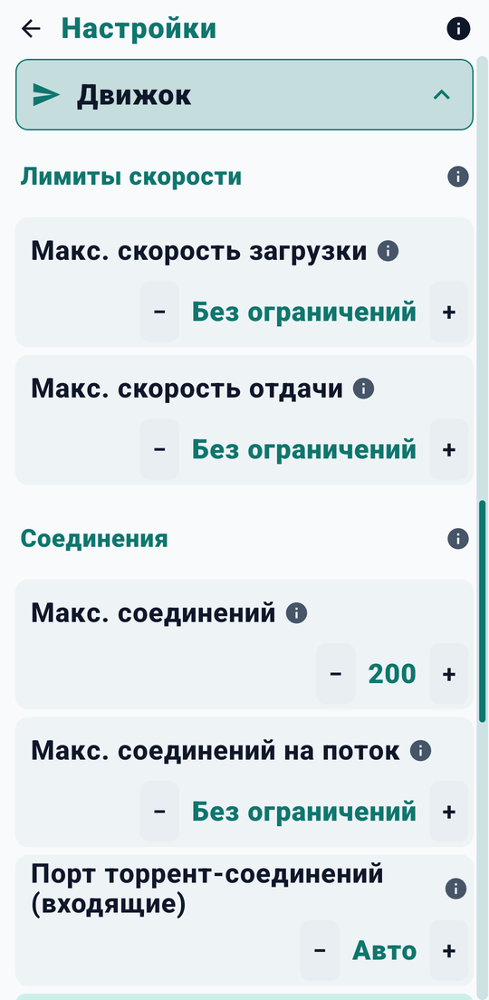
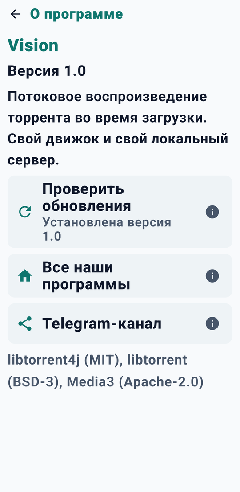
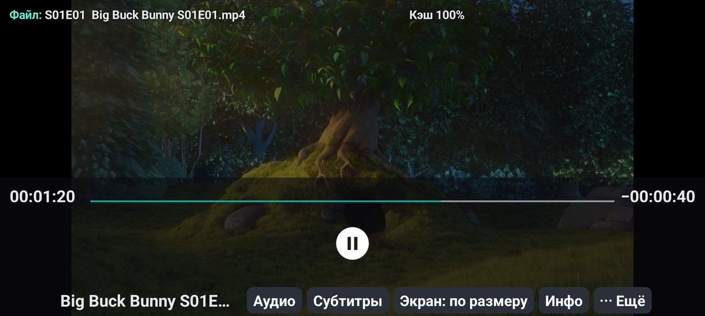
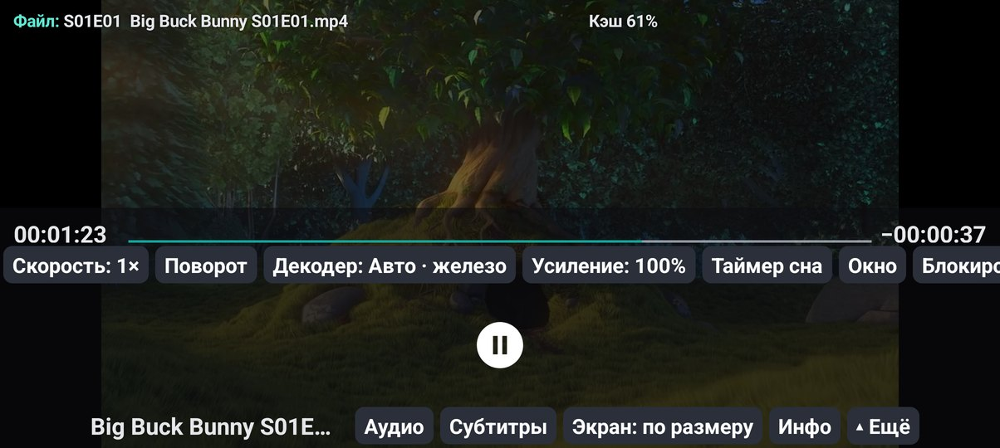

[English](README.md) · [Русский](README.ru.md) · [Українська](README.uk.md)

🌐 Все наши программы: https://drugoj00.github.io/ · Telegram-канал: https://t.me/PhoneInWindowSound

# Vision

Медиаплеер для телефонов и ТВ-приставок на Android: торренты, IPTV, сетевые папки, автогромкость. Свой движок, без рекламы.

Vision воспроизводит видео, звук и ТВ-каналы из файлов, ссылок, плейлистов, сетевых папок (SMB, WebDAV, DLNA, FTP, SFTP) и торрентов, в том числе во время загрузки. Автогромкость выравнивает звук и усмиряет громкую рекламу. Вставь ссылку, открой файл или плейлист, нажми «Смотреть».

**Программа не предоставляет контент. Пользователь отвечает за соблюдение законов своей страны об авторском праве.**

⭐ Если программа пригодилась, поставь звезду этому репозиторию: это бесплатно и помогает другим её найти.

## Скачать

**Версия 1.0.** [Vision-1.0.apk](https://github.com/drugoj00/torrent-player/releases/download/v1.0/Vision-1.0.apk) · [Releases](https://github.com/drugoj00/torrent-player/releases)

SHA-256: `01dbef93104bc3ce3d5b0be5c436bee750c90cbd5bdf7d8842cefc61c0db4ec0`

Нет в Google Play: скачай APK здесь. Android может предупредить об установке из неизвестного источника.

## Что нового в 1.0

- Торренты по magnet и .torrent, просмотр во время загрузки
- Серии с полоской просмотра, «Продолжить» и автопереход
- Автогромкость: ТВ-режим срезает громкую рекламу
- IPTV-плейлисты, панель каналов поверх видео, программа передач
- Жесты свайпом, повтор A-B, закладки, скорость 0,25-4×, «картинка в картинке»
- Сетевые папки: SMB, WebDAV, DLNA, FTP, SFTP
- Встроенные программные декодеры видео, звука и AV1
- Настройки по группам с поиском, резервная копия и восстановление
- Русский, украинский и английский, светлая, тёмная и чёрная темы

## Возможности

- **Торренты.** Magnet-ссылка, файл или ссылка на .torrent, «Поделиться» из другого приложения. Сначала список файлов, потом качается только выбранный файл в окне вокруг места просмотра. Перемотка в любое место.
- **Плеер.** Media3: внешние субтитры (.srt, .ass, .vtt), выбор аудио- и субтитровых дорожек, размер кадра, скорость, повтор A-B, закладки, поворот и зеркало картинки, усиление громкости до 200%, жесты свайпом, таймер сна, «картинка в картинке» и своё плавающее окно. Пульт, касание и мышь.
- **Автогромкость.** ТВ-режим, который усмиряет громкую рекламу; выключатель в настройках и в панели «Аудио».
- **IPTV.** Плейлисты M3U, M3U8, XSPF и PLS, прозрачная панель каналов с группами, избранным и поиском, программа передач XMLTV.
- **Источники.** SMB, WebDAV, DLNA, FTP, SFTP и папки устройства; коллекции «Видео» и «Аудио» с полоской «где остановился».
- **Локальный сервер.** Отдаёт файл по HTTP с поддержкой Range; «Доступ из сети» открывает его для локальной сети (VLC, телевизор, браузер). Страница в браузере добавляет торрент с телефона или компьютера.
- **Движок.** Лимиты скорости, соединения, порт, DHT и LSD, мобильная сеть, запас вперёд, кэш в памяти устройства или на внешнем накопителе.
- **Настройки.** Девять групп с поиском, полная резервная копия и восстановление.
- **Обновления.** Проверка обновлений на GitHub с проверкой файла и окном «Что нового».

## Требования и ограничения

- Android 6.0 и новее (ARMv7, ARM64, x86_64).
- Для торрентов и IPTV нужен интернет. В странах с запретом торренты блокируются до подтверждения; страна определяется без интернета. NFS и движок Ace Stream не поддерживаются.
- Программный AV1 на слабых приставках: 720p плавно, 1080p с пропусками кадров, 4K не тянет.
- Для плавающего окна нужно разрешение «Поверх других приложений»; «картинка в картинке» работает там, где её поддерживает система.
- Проверено на телефоне с Android 15 и на ТВ-приставке. Не проверено: торрент-движок и часть пунктов «Движок» на приставке, ТВ-раскладка новой панели плеера, автомагнитолы, порталы Stalker, архивы программы передач (zip, JTV), напоминания, кэш на внешнем накопителе, проброс Dolby/DTS на настоящей HDMI-технике.

## Скриншоты

   

 

 

## Лицензия

GPL-3.0. Библиотеки: libtorrent4j (MIT), libtorrent (BSD-3), Media3 (Apache-2.0), FFmpeg (LGPL-2.1+). Демо-видео на скриншотах: «Big Buck Bunny», Blender Foundation (CC BY 3.0).
