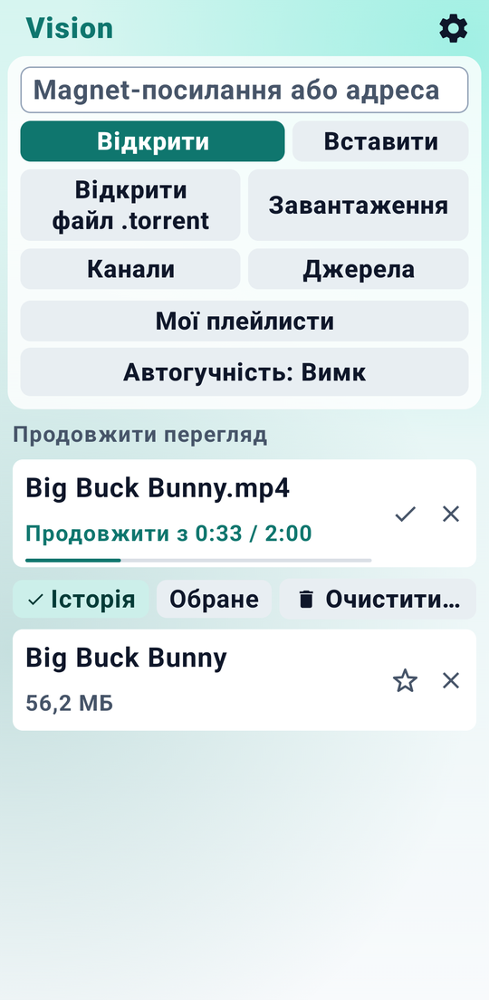
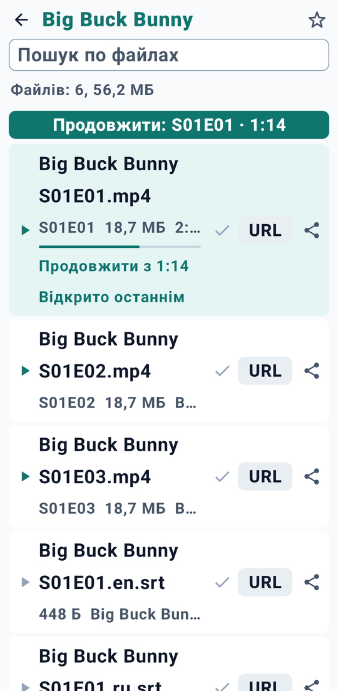
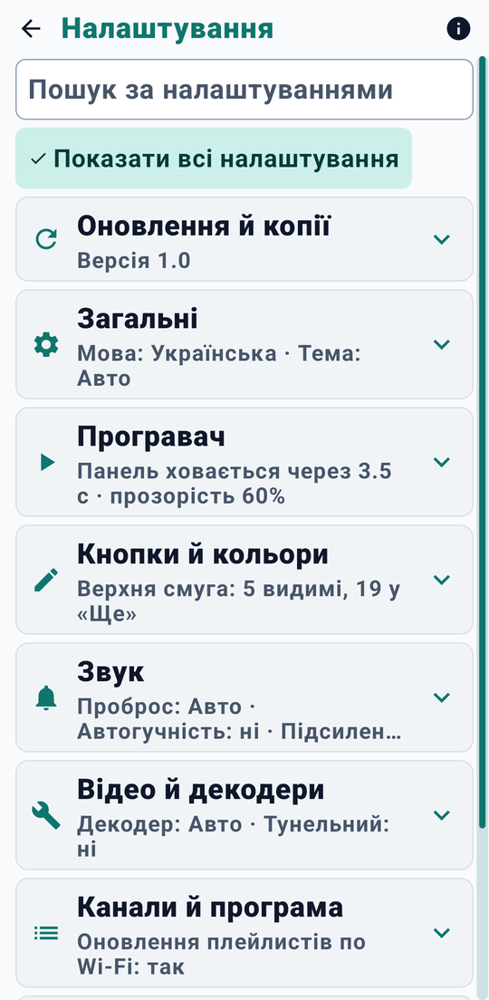
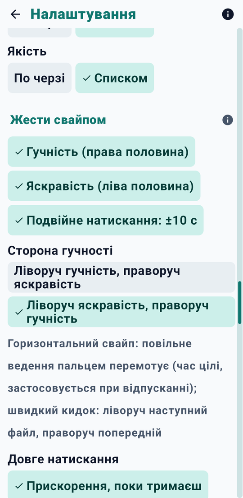
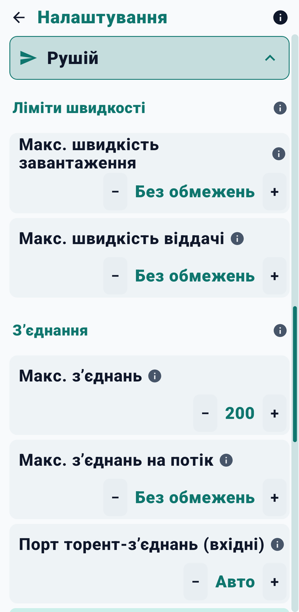
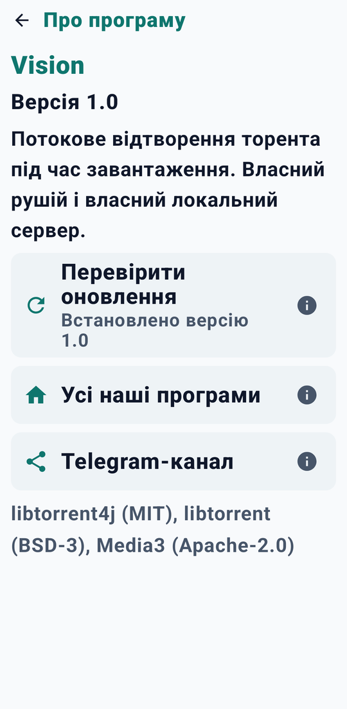
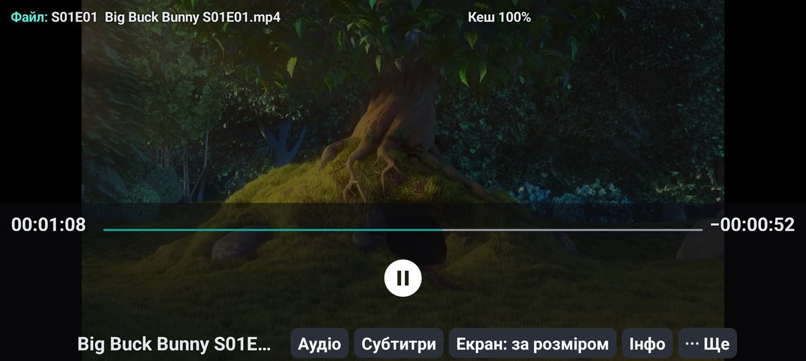
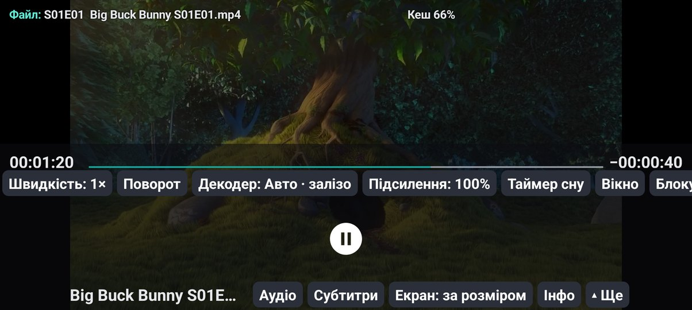

[English](README.md) · [Русский](README.ru.md) · [Українська](README.uk.md)

🌐 Усі наші програми: https://drugoj00.github.io/ · Telegram-канал: https://t.me/PhoneInWindowSound

# Vision

Медіаплеєр для телефонів і ТБ-приставок на Android: торенти, IPTV, мережеві теки, автогучність. Власний рушій, без реклами.

Vision відтворює відео, звук і ТБ-канали з файлів, посилань, плейлистів, мережевих тек (SMB, WebDAV, DLNA, FTP, SFTP) і торентів, зокрема під час завантаження. Автогучність вирівнює звук і вгамовує гучну рекламу. Встав посилання, відкрий файл або плейлист, натисни «Дивитися».

**Програма не надає вміст. Користувач відповідає за дотримання законів своєї країни про авторське право.**

⭐ Якщо програма стала в пригоді, постав зірку цьому репозиторію: це безкоштовно й допомагає іншим її знайти.

## Завантажити

**Версія 1.0.** [Vision-1.0.apk](https://github.com/drugoj00/torrent-player/releases/download/v1.0/Vision-1.0.apk) · [Releases](https://github.com/drugoj00/torrent-player/releases)

SHA-256: `01dbef93104bc3ce3d5b0be5c436bee750c90cbd5bdf7d8842cefc61c0db4ec0`

Немає в Google Play: завантаж APK тут. Android може попередити про встановлення з невідомого джерела.

## Що нового в 1.0

- Торенти за magnet і .torrent, перегляд під час завантаження
- Серії зі смужкою перегляду, «Продовжити» й автоперехід
- Автогучність: ТБ-режим зрізає гучну рекламу
- IPTV-плейлисти, панель каналів поверх відео, телепрограма
- Жести свайпом, повтор A-B, закладки, швидкість 0,25-4×, «картинка в картинці»
- Мережеві теки: SMB, WebDAV, DLNA, FTP, SFTP
- Вбудовані програмні декодери відео, звуку й AV1
- Налаштування за групами з пошуком, резервна копія й відновлення
- Українська, російська й англійська, світла, темна й чорна теми

## Можливості

- **Торенти.** Magnet-посилання, файл або посилання на .torrent, «Поділитися» з іншого застосунку. Спершу список файлів, потім завантажується лише вибраний файл у вікні навколо місця перегляду. Перемотування в будь-яке місце.
- **Плеєр.** Media3: зовнішні субтитри (.srt, .ass, .vtt), вибір аудіо- й субтитрових доріжок, розмір кадру, швидкість, повтор A-B, закладки, поворот і дзеркало картинки, підсилення гучності до 200%, жести свайпом, таймер сну, «картинка в картинці» і власне плаваюче вікно. Пульт, дотик і миша.
- **Автогучність.** ТБ-режим, що вгамовує гучну рекламу; вимикач у налаштуваннях і в панелі «Аудіо».
- **IPTV.** Плейлисти M3U, M3U8, XSPF і PLS, прозора панель каналів із групами, обраним і пошуком, телепрограма XMLTV.
- **Джерела.** SMB, WebDAV, DLNA, FTP, SFTP і теки пристрою; добірки «Відео» й «Аудіо» зі смужкою «де зупинився».
- **Локальний сервер.** Віддає файл по HTTP із підтримкою Range; «Доступ із мережі» відкриває його для локальної мережі (VLC, телевізор, браузер). Сторінка в браузері додає торент із телефона або комп’ютера.
- **Рушій.** Ліміти швидкості, з’єднання, порт, DHT і LSD, мобільна мережа, запас уперед, кеш у пам’яті пристрою або на зовнішньому накопичувачі.
- **Налаштування.** Дев’ять груп із пошуком, повна резервна копія й відновлення.
- **Оновлення.** Перевірка оновлень на GitHub із перевіркою файлу та вікном «Що нового».

## Вимоги й обмеження

- Android 6.0 і новіші (ARMv7, ARM64, x86_64).
- Для торентів і IPTV потрібен інтернет. У країнах із забороною торенти блокуються до підтвердження; країна визначається без інтернету. NFS і рушій Ace Stream не підтримуються.
- Програмний AV1 на слабких приставках: 720p плавно, 1080p із пропусками кадрів, 4K не тягне.
- Для плаваючого вікна потрібен дозвіл «Поверх інших застосунків»; «картинка в картинці» працює там, де її підтримує система.
- Перевірено на телефоні з Android 15 і на ТБ-приставці. Не перевірено: торент-рушій і частина пунктів «Рушій» на приставці, ТБ-розкладка нової панелі плеєра, автомагнітоли, портали Stalker, архіви телепрограми (zip, JTV), нагадування, кеш на зовнішньому накопичувачі, прокидання Dolby/DTS на справжній HDMI-техніці.

## Знімки екрана

   

 

 

## Ліцензія

GPL-3.0. Бібліотеки: libtorrent4j (MIT), libtorrent (BSD-3), Media3 (Apache-2.0), FFmpeg (LGPL-2.1+). Демо-відео на знімках: «Big Buck Bunny», Blender Foundation (CC BY 3.0).
